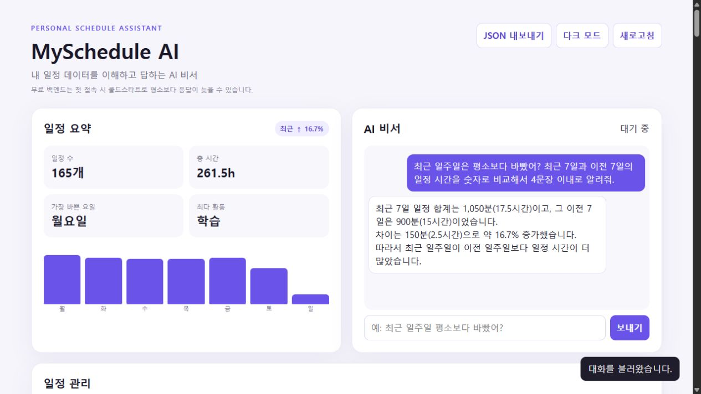
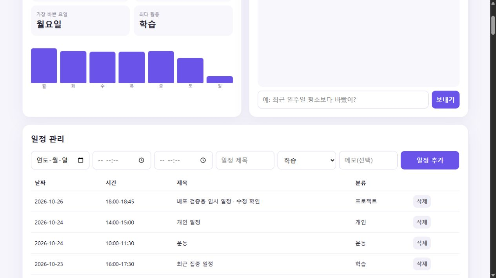
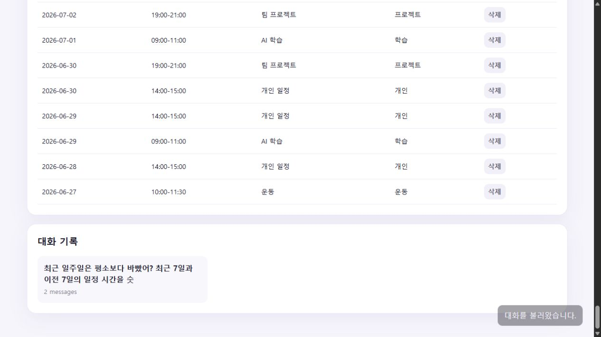

# MySchedule AI

개인의 일정 기록을 분석하고, 요약 정보를 AI 대화에 반영하는 일정 관리 서비스입니다.

## 주요 기능

- 일정 생성·조회·수정·삭제
- 일정 시간, 날짜, 요일, 카테고리별 분석 Summary
- 사용자의 일정 Summary를 문맥으로 주입하는 AI 채팅
- 대화 기록 저장 및 다시 불러오기
- 시연용 데이터 생성, 데이터 내보내기, 다크 모드

## 기술 스택

- Backend: Python 3.10+, FastAPI, Pydantic
- Database: Firebase Firestore
- AI: OpenAI-compatible Chat Completions API
- Frontend: HTML, CSS, Vanilla JavaScript
- Tests: pytest, Node.js built-in test runner

## 환경 변수

실제 값은 로컬의 `.env` 또는 배포 서비스의 비밀 환경 변수에 설정합니다. `.env`, OpenAI 키, Firebase 서비스 계정 JSON은 저장소에 커밋하지 않습니다.

| 환경 변수 | 적용 위치 | 용도 |
|---|---|---|
| `OPENAI_API_KEY` | Backend | OpenAI 호환 API 인증 키 |
| `OPENAI_MODEL` | Backend | 사용할 채팅 모델 |
| `OPENAI_BASE_URL` | Backend | OpenAI 호환 API 주소 |
| `FIREBASE_SERVICE_ACCOUNT_JSON` | Backend | 서비스 계정 JSON 내용 |
| `FIREBASE_SERVICE_ACCOUNT_PATH` | Backend | 서비스 계정 JSON 파일 경로 (`FIREBASE_SERVICE_ACCOUNT_JSON` 대안) |
| `ALLOWED_ORIGINS` | Backend | CORS에서 허용할 Frontend origin 목록 |
| `API_BASE_URL` | Frontend build | 배포된 Backend의 기본 주소 |

Firebase를 연동하려면 Firebase 프로젝트에 Firestore를 만들고 서비스 계정 자격 증명을 준비합니다. 로컬에서는 위 두 서비스 계정 설정 중 하나를 사용하고, Render에서는 대시보드의 비밀 환경 변수로 설정합니다. Frontend 배포 빌드에는 `API_BASE_URL`이 필요합니다.

## 데이터 흐름

일정 입력 → FastAPI 검증 → Firestore 저장 → 서버 Summary 계산 → AI Context에 Summary 주입 → 답변 및 대화 기록 저장

AI는 Summary와 저장된 데이터를 근거로 답변하며, 기록에 없는 일정을 사실처럼 만들지 않도록 안내됩니다.

## 주요 API

| Method | Endpoint | 설명 |
|---|---|---|
| POST | /api/data | 일정 추가 |
| GET | /api/data | 일정 목록 |
| PUT | /api/data/{id} | 일정 수정 |
| DELETE | /api/data/{id} | 일정 삭제 |
| GET | /api/data/summary | 일정 분석 Summary |
| POST | /api/chat | Summary를 주입한 AI 대화 |
| POST | /api/conversations | 대화 생성 |
| GET | /api/conversations | 대화 목록 |
| GET | /api/conversations/{id} | 대화 상세 |
| DELETE | /api/conversations/{id} | 대화 삭제 |

## 로컬 실행

명령은 `M1-2` 폴더를 기준으로 실행합니다. Backend와 Frontend는 각각 다른 터미널에서 실행합니다.

Backend (Windows PowerShell):

    cd backend
    python -m venv .venv
    .venv\Scripts\python.exe -m pip install -r requirements-dev.txt
    .venv\Scripts\python.exe -m uvicorn app.main:app --reload

실제 Firebase 및 AI 연동 자격 증명은 이 저장소에 포함하지 않습니다. 로컬에서는 환경 변수를 `.env`에 설정한 뒤 Backend를 실행합니다.

Frontend:

    cd frontend
    python -m http.server 5500

브라우저에서 http://localhost:5500 에 접속합니다. 로컬 `config.js`는 http://localhost:8000 의 Backend를 사용합니다.

배포용 빌드는 Frontend 폴더에서 다음과 같이 실행합니다.

    $env:API_BASE_URL = "https://myschedule-ai-api.onrender.com"
    npm run build

`scripts/generate-config.mjs`가 Backend 주소를 `dist/config.js`에 주입합니다. `API_BASE_URL`이 없으면 빌드는 실패합니다. Frontend 테스트는 `npm test`로 실행합니다.

## Seed 데이터와 테스트

    cd backend
    .venv\Scripts\python.exe scripts/seed_data.py --dry-run
    .venv\Scripts\python.exe -m pytest -q

Seed 스크립트는 분석할 수 있는 패턴을 가진 100개 이상의 시연 일정을 생성합니다. 실제 데이터베이스에 업로드하기 전에 dry-run 결과를 확인하세요.

자격 증명을 설정한 빈 시연 데이터베이스에 업로드하려면 `scripts/seed_data.py`를 `--dry-run` 없이 실행합니다. 다시 실행하면 중복 일정이 생기므로 기존 시연 데이터가 있으면 재실행하지 않습니다.

## 배포 및 제출

- GitHub 저장소: https://github.com/hongbinwee/codyssey-m
- Render Backend URL: https://myschedule-ai-api.onrender.com
- Swagger URL: https://myschedule-ai-api.onrender.com/docs
- Vercel Frontend URL: https://myschedule-ai.vercel.app

Render 배포 설정:

| 항목 | 값 |
|---|---|
| 서비스 | Python 3 Web Service, Free |
| Root Directory | `M1-2/backend` |
| Build Command | `pip install -r requirements.txt` |
| Start Command | `uvicorn app.main:app --host 0.0.0.0 --port $PORT` |
| Health Check Path | `/health` |

Vercel은 `frontend` 폴더의 실행 파일을 직접 업로드해 배포했습니다. Build Command는 `npm run build`, Output Directory는 `dist`입니다. Git 저장소를 연결해 배포할 때는 Root Directory를 `M1-2/frontend`로 지정합니다. Vercel의 `API_BASE_URL`에는 위 Render 주소를, Render의 `ALLOWED_ORIGINS`에는 실제 Vercel origin을 설정합니다.

2026-10-26 배포 후 `/health`·Swagger·Summary 응답, 임시 일정의 추가·새로고침 후 유지·수정·삭제, 실제 AI 답변 1회, 저장된 대화의 화면 복원을 확인했습니다. AI 호출은 배포된 API에서 수행했고, 대화 불러오기는 실제 Vercel 화면에서 검증했습니다. 허용한 Vercel 주소의 CORS 요청은 HTTP 200, 다른 출처는 HTTP 400이었습니다.

무료 Render 인스턴스는 사용하지 않는 동안 중지될 수 있습니다. 첫 접속이 느리면 잠시 기다린 뒤 화면의 새로고침을 눌러 주세요.

실제 일정 데이터 대신 생성형 시연 데이터를 사용하세요. 공개 앱에는 사용자 인증이 구현되어 있지 않습니다.

## 제출 스크린샷

아래 이미지는 실제 배포 사이트에서 생성형 시연 데이터를 사용해 캡처했습니다. API 키와 자격 증명은 포함하지 않습니다.

### 일정 요약을 반영한 AI 대화

서버 Summary를 근거로 최근 두 기간을 비교한 실제 AI 답변입니다. 저장된 대화를 화면에 불러온 상태입니다.

### 일정 관리

화면에서 임시 일정을 추가하고 새로고침 후 유지를 확인한 뒤, API로 종료 시간을 수정한 결과입니다. 캡처 후 해당 임시 일정은 삭제했습니다.

### 대화 기록 불러오기

이전 대화를 선택하면 질문과 답변이 위 AI 대화 영역에 복원됩니다. 새로고침 뒤에도 같은 메시지가 복원되는 것을 확인했습니다.

