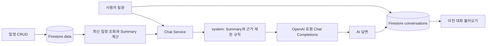

# MySchedule AI

**내 일정 데이터를 이해하고 답하는 AI 비서** — M1-2 「AI Agent 개발: 나만의 AI 비서 구축」 제출 프로젝트입니다.

일정을 기록해도 어느 요일에 바빴는지, 최근 일정량이 늘었는지 파악하기는 어렵습니다. MySchedule AI는 Firestore에 저장한 일정의 시간·요일·활동 분포와 최근 추세를 서버에서 계산하고, 그 요약을 AI의 시스템 프롬프트에 주입해 질문에 답합니다.

## 배포 URL

| 제출 항목 | 주소 |
|---|---|
| 웹 서비스 · Vercel | [myschedule-ai.vercel.app](https://myschedule-ai.vercel.app) |
| 백엔드 API · Render | [myschedule-ai-api.onrender.com](https://myschedule-ai-api.onrender.com) |
| Swagger API 문서 | [/docs](https://myschedule-ai-api.onrender.com/docs) |
| 서버 상태 | [/health](https://myschedule-ai-api.onrender.com/health) |
| 소스 코드 | [GitHub · M1-2](https://github.com/hongbinwee/codyssey-m/tree/main/M1-2) |

무료 Render 서버는 첫 요청 시 시작에 시간이 걸릴 수 있습니다. 화면에 콜드스타트 안내와 로딩 상태가 있으며, 60초 안에 응답이 없으면 재시도 안내를 표시합니다. 첫 연결이 실패하면 잠시 후 **새로고침**을 눌러 주세요.

## 미션 요구사항과 구현

| 필수 항목 | 구현 내용 |
|---|---|
| 데이터 기반 AI 채팅 | 최신 일정 Summary를 주입한 답변, 사용자·AI 메시지, 응답 대기 표시 |
| 데이터 CRUD | 화면에서 일정 추가·목록·삭제, Swagger/API에서 수정까지 지원 |
| 데이터 요약 표시 | 분석 기간, 일정 수, 총 시간, 가장 바쁜 요일, 주요 활동, 최근 추세 |
| 시계열 데이터 100개 이상 | 약 120일의 패턴을 가진 seed; 최종 dry-run 165개 생성 |
| 대화 저장·불러오기 | 질문·답변 자동 저장, 이전 대화 목록, 선택한 대화의 전체 메시지 복원 |
| 검증·예외 처리 | Pydantic 입력 검증, 잘못된 수정 422, 없는 항목 404, AI 연결 실패 안내 |
| 고정 스택·배포 | FastAPI·Firestore·OpenAI SDK / HTML·CSS·Vanilla JS / Render·Vercel |
| 제출 문서·화면 | 실행·환경 변수·배포 안내와 실제 서비스 스크린샷 3종 |

선택 기능으로 **요일별 막대 그래프, 추가 통계, JSON 내보내기, 다크 모드**를 구현했습니다. Function Calling, MCP/GPT Actions, Google Calendar 연동은 구현하지 않았습니다.

## 기술 스택과 아키텍처

| 영역 | 기술 |
|---|---|
| Backend | Python 3.10+, FastAPI, Uvicorn, Pydantic, python-dotenv |
| Database | Firebase Firestore, firebase-admin |
| AI | OpenAI Python SDK · OpenAI 호환 Chat Completions API |
| Frontend | HTML, CSS, Vanilla JavaScript — 프레임워크 없음 |
| Test | pytest, httpx MockTransport, Node.js 기본 테스트 러너 |
| Deployment | Backend: Render / Frontend: Vercel |

```text
M1-2/
├─ backend/
│  ├─ app/
│  │  ├─ main.py / dependencies.py  # 앱·CORS·의존성 주입
│  │  ├─ core/                     # 환경 변수·Firebase 초기화
│  │  ├─ models/                   # Pydantic 검증
│  │  ├─ routers/                  # HTTP 요청·응답
│  │  ├─ services/                 # 분석·프롬프트·AI·채팅 처리
│  │  └─ repositories/             # Firestore 접근
│  ├─ scripts/seed_data.py
│  ├─ tests/
│  └─ requirements*.txt
├─ frontend/
│  ├─ index.html / styles.css / app.js
│  ├─ config.js                    # 로컬 API 주소
│  ├─ scripts/generate-config.mjs   # 배포 시 API 주소 주입
│  ├─ tests/
│  └─ package.json
└─ docs/
   ├─ CHECKLIST.md / VALIDATION_REPORT.md
   └─ screenshots/
```

Router는 HTTP 계약, Model은 입력 검증, Service는 분석과 AI 처리, Repository는 Firestore 읽기·쓰기를 담당합니다. 테스트에서는 Repository와 AI를 대체해 외부 자격 증명 없이 핵심 흐름을 확인합니다.

## 데이터와 분석 기준

관심 시계열 데이터는 **날짜별 개인 일정과 활동 시간**입니다. 기본 `(date, value, memo)`에 제목·시작/종료 시각·카테고리를 추가했습니다. `value`의 단위는 **분**입니다.

| Firestore 컬렉션 | 저장 필드 |
|---|---|
| `data` | `date`, `start_time`, `end_time`, `value`, `title`, `category`, `memo`, `created_at`, `updated_at` |
| `conversations` | `title`, `messages: [{role, content}]`, `created_at`, `updated_at` |

문서 ID는 Firestore가 생성합니다. 일정의 생성·수정 시각은 DB에 저장하며, 일정 API 응답은 `id`와 일정 필드를 반환합니다. 대화 API는 messages와 생성·수정 시각도 반환합니다.

일정은 같은 날짜 안에서 `end_time > start_time`이어야 합니다. `value`는 1~1440분 범위이며 실제 시간 차이와 5분을 초과해 다르면 422를 반환합니다. 수정도 기존 값과 합쳐 전체 모델을 다시 검증합니다. 카테고리는 `study`, `project`, `meeting`, `exercise`, `personal`, `other`입니다.

`GET /api/data/summary`의 분석 항목:

| 필드 | 의미 |
|---|---|
| `period`, `count` | 기록의 최소~최대 날짜, 전체 일정 개수 |
| `metrics.total_minutes`, `total_hours` | 전체 일정 시간 |
| `metrics.average_daily_minutes` | **기록이 있는 날짜**의 일별 시간 평균 |
| `metrics.max_daily_minutes`, `min_daily_minutes` | 기록일 기준 일별 최대·최소 시간 |
| `busiest_day`, `busiest_weekday`, `top_category` | 시간이 가장 많은 날짜·요일·카테고리 |
| `category_distribution`, `weekday_distribution` | 카테고리별·요일별 누적 시간(분) |
| `recent_trend` | 최근 7일·이전 7일 시간, 변화율, 증가·감소·유지 |

최근 7일은 서버 날짜 기준 오늘부터 6일 전까지, 이전 7일은 7~13일 전입니다. 변화율은 `(최근 - 이전) / 이전 × 100`을 소수점 한 자리로 계산하고 **±5% 이내는 `maintain`**으로 표시합니다. 이전 기간만 0분이면 변화율은 `null`, 두 기간 모두 0분이면 `maintain`과 0%입니다. 전체 데이터가 없으면 `no_data`입니다. 기록이 없다는 사실을 실제 활동이 없었다는 뜻으로 해석하지 않습니다.

Seed는 고정 난수와 요일별 학습·프로젝트·운동 패턴, 최근 7일의 추가 학습 일정으로 구성됩니다. 생성 개수와 추세는 실행 기준 날짜에 따라 달라집니다. 기존 seed를 매번 갱신할 필요는 없으며, 오래된 데이터는 최근 비교 기간에 기록이 없을 수 있습니다.

## AI Context Injection



`/api/chat`은 매 요청마다 최신 일정을 조회하고, Summary API와 같은 분석 서비스를 사용합니다. `prompt_service.py`가 Summary JSON과 답변 규칙을 `system` 메시지에 넣고, 사용자 질문은 `user` 메시지로 전달합니다. **전체 원본 일정은 AI에 보내지 않습니다.** 답변을 받으면 user/assistant 메시지 쌍을 자동 저장하고 대화 ID와 답변을 반환합니다. Summary는 요청 시 계산하며 별도 컬렉션에 저장하지 않습니다.

프롬프트는 기록에 없는 사실을 만들지 말고, 특정 날짜의 상세 일정처럼 Summary만으로 알 수 없는 내용은 확인할 수 없다고 답하도록 명시합니다. 모델은 `OPENAI_MODEL`, 요청당 출력 상한은 `OPENAI_MAX_COMPLETION_TOKENS`로 관리합니다. 출력 토큰 상한은 전체 비용 한도나 호출 횟수 제한을 뜻하지 않습니다.

## API 목록

| Method | Endpoint | 동작 |
|---|---|---|
| POST | `/api/data` | 일정 생성 · 201 |
| GET | `/api/data` | 일정 목록 |
| PUT | `/api/data/{id}` | 전달한 필드 수정 및 최종 일정 검증 |
| DELETE | `/api/data/{id}` | 일정 삭제 · 204 |
| GET | `/api/data/summary` | 분석 요약 |
| POST | `/api/conversations` | 제목·메시지로 대화 생성 · 201 |
| GET | `/api/conversations` | 최근 갱신 순 대화 목록, messages 포함 |
| GET | `/api/conversations/{id}` | 대화 전체 메시지 |
| DELETE | `/api/conversations/{id}` | 대화 삭제 · 204 |
| POST | `/api/chat` | Summary 기반 AI 답변 및 자동 저장 |
| GET | `/health` | 앱 실행 상태 |

Swagger의 **Try it out**에서 API를 실행할 수 있습니다. 일정 생성 예시입니다.

```json
{"date":"2026-10-26","start_time":"09:00","end_time":"10:00","value":60,"title":"AI 학습","category":"study","memo":"API 테스트"}
```

채팅 요청은 `{"message":"최근 일주일은 평소보다 바빴어?"}` 형태입니다. 응답의 `conversation_id`를 다음 요청에 함께 보내면 같은 대화에 저장합니다. UI에서 이전 대화를 선택해도 해당 ID를 이어 사용합니다.

## 환경 변수와 Firebase 설정

실제 `.env`와 서비스 계정 JSON은 저장소에 포함하지 않습니다. **`backend/.env`를 직접 생성**하고 배포 시에는 서비스 대시보드 환경 변수에 설정합니다. 프론트엔드에 Firebase·AI 비밀키를 넣지 않습니다.

| 이름 | 위치 | 필수 여부·기본값 |
|---|---|---|
| `OPENAI_API_KEY` | Backend | 실제 AI 호출 시 필수. 교육기관 virtual key 또는 OpenAI 키 |
| `OPENAI_MODEL` | Backend | 기본 `gpt-5-mini` |
| `OPENAI_BASE_URL` | Backend | 기본 `https://copa.codyssey.kr/v1` — 교육기관 호환 API |
| `OPENAI_MAX_COMPLETION_TOKENS` | Backend | 기본 `2048`, 범위 256~8192 |
| `FIREBASE_SERVICE_ACCOUNT_PATH` | Backend | 로컬 JSON 파일 경로. JSON 변수와 둘 중 하나 사용 |
| `FIREBASE_SERVICE_ACCOUNT_JSON` | Backend | 서비스 계정 JSON 내용. Render에서는 이 방식 사용 |
| `ALLOWED_ORIGINS` | Backend | 쉼표로 구분한 프론트 origin. 기본 localhost·127.0.0.1의 5500 포트 |
| `API_BASE_URL` | Frontend build | 배포 빌드 시 필수. Render 기본 주소, `/api` 제외 |

로컬 `backend/.env` 예시입니다. 빈 키를 본인 키로 채우고 JSON 경로를 실제 파일 위치로 바꾸세요.

```dotenv
OPENAI_API_KEY=
OPENAI_MODEL=gpt-5-mini
OPENAI_BASE_URL=https://copa.codyssey.kr/v1
OPENAI_MAX_COMPLETION_TOKENS=2048
FIREBASE_SERVICE_ACCOUNT_PATH=C:/secure/firebase-admin.json
ALLOWED_ORIGINS=http://localhost:5500,http://127.0.0.1:5500
```

`OPENAI_BASE_URL`은 인증 키가 아닌 서버 주소입니다. 개인 OpenAI 키를 쓰면 주소도 `https://api.openai.com/v1`로 맞춥니다. 교육기관 키는 교육기관 주소와 함께 사용합니다. 환경 변수 변경 후 백엔드를 다시 시작하세요.

Firebase 준비:

1. Firebase Console에서 프로젝트와 Firestore `(default)` 데이터베이스를 준비합니다. 현재 시연 DB는 Standard, 서울(`asia-northeast3`)입니다.
2. 프로젝트 설정 → 서비스 계정 → Firebase Admin SDK에서 JSON을 발급받아 **저장소 밖**에 보관합니다.
3. 로컬에서는 `FIREBASE_SERVICE_ACCOUNT_PATH`, Render에서는 `FIREBASE_SERVICE_ACCOUNT_JSON`에 설정합니다. 둘 다 있으면 JSON 변수가 우선합니다.
4. Backend가 Admin SDK로 접근하므로 프론트 앱 등록·Firebase 브라우저 SDK는 필요하지 않습니다. Firestore 클라이언트 규칙을 공개 읽기·쓰기로 바꿀 필요도 없습니다.

`data`와 `conversations`는 첫 저장 시 생성됩니다. `/health`·Swagger가 열리는 것과 Firebase·AI 연결 성공은 별개이므로 실제 기능도 확인해야 합니다.

## 로컬 실행 · Windows PowerShell

Python 3.10+와 Node.js 20+를 준비합니다. 프론트는 런타임 의존 패키지가 없고 Node.js는 빌드·테스트에 사용합니다.

첫 번째 터미널:

```powershell
git clone https://github.com/hongbinwee/codyssey-m.git
cd codyssey-m/M1-2/backend
python --version
python -m venv .venv
.\.venv\Scripts\python.exe -m pip install -r requirements-dev.txt
# 위 안내에 따라 backend/.env 작성
.\.venv\Scripts\python.exe -m uvicorn app.main:app --reload
```

다른 터미널에서 `M1-2/frontend`로 이동한 뒤:

```powershell
python -m http.server 5500
```

[localhost:5500](http://localhost:5500), [localhost:8000/docs](http://localhost:8000/docs)를 엽니다. 로컬 `frontend/config.js`는 `http://localhost:8000`을 사용합니다. HTML을 직접 여는 대신 위 HTTP 서버로 실행하세요.

## Seed와 테스트

Backend 폴더에서:

```powershell
# 업로드 없이 생성 개수 확인 — 자격 증명 불필요
.\.venv\Scripts\python.exe scripts/seed_data.py --dry-run
# Firebase 설정 후 빈 시연 DB에 최초 한 번 업로드
.\.venv\Scripts\python.exe scripts/seed_data.py
# fake Repository·AI 테스트 — 실제 외부 호출 없음
.\.venv\Scripts\python.exe -m pytest -q
```

Seed를 반복 업로드하면 중복 일정이 추가됩니다. 이미 100개 이상 있는 현재 시연 DB에는 다시 업로드하지 않습니다.

Frontend 폴더에서:

```powershell
npm test
node --check app.js
node --check scripts/generate-config.mjs
$env:API_BASE_URL = "https://myschedule-ai-api.onrender.com"
npm run build
```

2026-10-26 최종 로컬 검증: **백엔드 14개·프론트 8개 통과**, JavaScript 문법·배포 빌드 통과, seed dry-run **165개**. 테스트는 CRUD·Summary·컨텍스트 전달·자동 저장·잘못된 수정·AI 공급자 오류와 프론트 기간 표시·오류 안내·요청 시간 초과·배포 설정 주입을 확인합니다. 실제 외부 연동 결과는 [검증 보고서](docs/VALIDATION_REPORT.md)에 구분했습니다.

## 배포 설정

### Backend · Render

| 항목 | 값 |
|---|---|
| 서비스 | Python 3 Web Service · Free |
| 저장소 / 브랜치 | `hongbinwee/codyssey-m` / `main` |
| Root Directory | `M1-2/backend` |
| Build Command | `pip install -r requirements.txt` |
| Start Command | `uvicorn app.main:app --host 0.0.0.0 --port $PORT` |
| Health Check Path | `/health` |

AI 설정과 `FIREBASE_SERVICE_ACCOUNT_JSON`을 Render 환경 변수에 넣습니다. `ALLOWED_ORIGINS`에는 `https://myschedule-ai.vercel.app`, `https://myschedule-ai-projecthong1.vercel.app` 및 필요한 로컬 origin을 쉼표로 구분해 설정합니다. origin 끝에는 `/`를 붙이지 않습니다. 현재 서비스는 공개 Git 주소로 연결했고 **Manual Deploy → Deploy latest commit**으로 수정본을 반영합니다.

### Frontend · Vercel

| 항목 | 값 |
|---|---|
| 프로젝트 | `myschedule-ai` |
| Framework | Other · Vanilla JavaScript |
| Git 연동 시 Root Directory | `M1-2/frontend` |
| Build Command | `npm run build` |
| Output Directory | `dist` |
| 환경 변수 | `API_BASE_URL=https://myschedule-ai-api.onrender.com` |

현재는 `frontend` 실행 파일을 프로젝트에 직접 업로드해 배포했습니다. Git 자동 배포를 연결한 상태로 가정하지 않습니다.

`API_BASE_URL` → `scripts/generate-config.mjs` → `dist/config.js` → `window.APP_CONFIG.API_BASE_URL` 순서로 주소가 주입됩니다. 변수가 없으면 배포 빌드를 실패시켜 localhost 주소가 실수로 배포되는 것을 막습니다. 환경 변수 변경 후에는 다시 빌드·배포해야 합니다.

## 시연 순서

1. 웹 서비스에서 분석 기간·일정 수·추세와 목록을 확인합니다.
2. 테스트 일정을 추가하고 목록·Summary 갱신과 새로고침 후 유지를 확인합니다. 화면에서 삭제하거나 Swagger의 PUT으로 수정할 수 있습니다.
3. **“최근 일주일은 평소보다 바빴어?”**, **“내가 시간을 가장 많이 쓴 활동은 뭐야?”**를 질문하고 로딩 후 데이터 기반 답변을 확인합니다.
4. 새로고침 후 대화 기록에서 제목을 선택해 저장된 질문·답변을 복원합니다.
5. Swagger에서 필수 API와 응답을 확인합니다.

## 제출 스크린샷

실제 배포 사이트에서 생성형 시연 데이터로 캡처했습니다.

### 일정 Summary와 AI 대화

서버가 계산한 최근 두 기간의 일정량을 비교한 실제 질문·답변입니다.


### 일정 관리 · CRUD

화면에서 임시 일정을 추가하고 새로고침 후 유지를 확인한 뒤, API 수정 결과가 목록에 반영된 화면입니다. 캡처 후 임시 일정은 삭제했습니다.


### 이전 대화 불러오기

저장된 대화를 선택하면 위 AI 비서 영역에 전체 메시지가 복원됩니다.


## 구현 범위와 확인할 점

- 공개 시연 앱은 사용자 인증·사용자별 데이터 분리가 없는 공유 공간이며 생성형 시연 데이터를 사용합니다.
- 대화는 같은 ID에 누적 저장하지만 AI에는 **최신 Summary와 현재 질문**만 전달합니다. 과거 메시지를 AI 문맥에 넣는 다중 턴 추론은 구현하지 않았습니다.
- 상세 일정 조회 도구가 없으므로 Summary에서 확인할 수 없는 날짜별 제목·메모를 AI가 조회할 수는 없습니다.
- 내장 브라우저의 삭제 확인창 자동화가 멈춰 화면 삭제의 최종 확인은 수동 점검 항목입니다. 실제 삭제 API와 삭제 후 목록·Summary 갱신은 임시 일정으로 검증했습니다.

상세 항목은 [제출 체크리스트](docs/CHECKLIST.md)와 [검증 보고서](docs/VALIDATION_REPORT.md)를 참고하세요.
